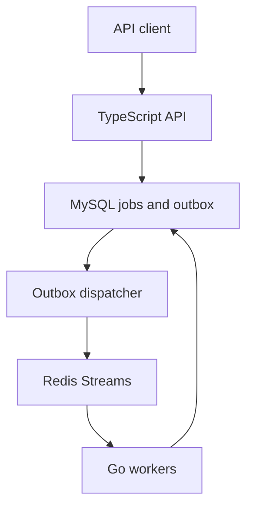

# ScaleQueue

A background-job processing demonstrator with a Node.js/TypeScript API, Go workers, MySQL as the durable source of truth, and Redis Streams for delivery.

The reliability model is **at-least-once delivery** with database-backed claims and fenced state transitions. Handlers can run again after a crash. External side effects require their own idempotency mechanism; this project does not claim universal exactly-once execution. Built-in email/notification handlers simulate work and do not send messages.

## Quick start

Requires Docker Engine and Docker Compose v2.

```bash
cp .env.example .env
docker compose up -d --build
curl http://127.0.0.1:3000/health
curl http://127.0.0.1:9090/ready
```

Compose waits for MySQL/Redis, runs migrations, seeds the demo API key, and starts API/workers. Services are exposed on loopback. Demo credentials in `.env.example` are for local use.

```bash
curl -X POST http://127.0.0.1:3000/api/v1/jobs \
  -H 'Content-Type: application/json' \
  -H 'x-api-key: local-demo-key-change-me' \
  -H 'Idempotency-Key: example-email-1' \
  -d '{"type":"send_email","payload":{"to":"demo@example.test"},"max_retries":3}'
```

The returned `data.id` identifies the job. Repeating the same normalized request and idempotency key for the same API client returns the same job; changing the request returns HTTP 409. Omitting the key creates a distinct job. Enqueue deduplication is independent of handler-side effect deduplication.

```bash
curl -H 'x-api-key: local-demo-key-change-me' http://127.0.0.1:3000/api/v1/jobs/JOB_ID
curl -H 'x-api-key: local-demo-key-change-me' http://127.0.0.1:3000/api/v1/jobs/JOB_ID/logs
curl -H 'x-api-key: local-demo-key-change-me' http://127.0.0.1:3000/api/v1/jobs/dead
curl http://127.0.0.1:9090/metrics
```

To demonstrate retries and DLQ, enqueue `{"type":"fail_job","payload":{"reason":"demo"},"max_retries":1}`. It makes at most two attempts, with a persisted delay before retry, then becomes `DEAD`. Replay explicitly:

```bash
curl -X POST -H 'x-api-key: local-demo-key-change-me' \
  http://127.0.0.1:3000/api/v1/jobs/JOB_ID/requeue
```

Replay resets the attempt budget and increments the generation. Concurrent replay requests cannot reset the same job twice. Old-generation messages are ignored. Only `DEAD`/legacy `FAILED` jobs are replayable.

Optional dashboard: run `python3 -m http.server 8081 --directory dashboard`, open localhost:8081, enter the local API URL and configured key. The dashboard is a static browser UI, not a Node server.

Stop with `docker compose down`. Named volumes retain data. **`docker compose down -v` deletes the demo database and Redis data.**

## Architecture



- Job acceptance and outbox insertion commit together in MySQL. Redis availability is not required to accept a valid job.
- The dispatcher locks due outbox rows, publishes, then records publication. A crash between publication and commit may duplicate delivery, but does not erase the dispatch intent.
- Pending outbox rows are republished at most once per 30 seconds. Retaining nonterminal intents also heals lost Redis stream deliveries; terminal/old-generation intents are removed when revisited.
- Claims serialize on a MySQL row lock. Unexpired processing leases reject competing execution. Heartbeats renew leases; stale owners cannot renew or persist outcomes.
- Completion, failure/audit, and any next-attempt outbox entry commit atomically. ACK follows successful persistence. Database/handler infrastructure errors leave deliveries pending.
- Recovery uses periodic cursor-based `XAUTOCLAIM`, scanning beyond the first 100 entries. Each worker has a unique process identity.
- Shutdown stops acquisition and gives cooperative handlers a bounded drain period. Interrupted attempts consume the persisted attempt budget and are recoverable after lease expiry.

See [reliability details](docs/reliability.md) for state transitions, failure behavior, upgrade instructions, and limits.

## Local development without Docker

Use Node.js 22+, Go 1.25.5, MySQL 8+, and Redis 7+. API and workers must share the same database and stream.

API environment: `DB_HOST`, `DB_PORT`, `DB_USER`, `DB_PASSWORD`, `DB_NAME`, `REDIS_URL`. Set `DB_SSL=true` only for a server with a trusted TLS certificate. Set `DEMO_API_KEY` for seeding.

```bash
cd api-service
npm ci
npm run migrate
node scripts/seed.cjs
npm run build
npm start
```

Worker environment: `MYSQL_URL` (Go MySQL DSN including `parseTime=true`), `REDIS_URL`. Optional settings:

| Variable | Default |
| --- | --- |
| `WORKER_COUNT` | `3` |
| `STREAM_NAME` | `jobs:queue` |
| `CONSUMER_GROUP` | `scalequeue-workers` |
| `LEASE_DURATION` | `30s` |
| `RECOVERY_INTERVAL` | `5s` |
| `RECOVERY_IDLE` | `30s` |
| `JOB_TIMEOUT` | `2m` |
| `SHUTDOWN_TIMEOUT` | `25s` |
| `HTTP_ADDR` | `:9090` |

```bash
cd worker-service
go run ./cmd/worker
```

Keep lease duration comfortably above database/network latency. Handlers must respect context cancellation. Startup requires both stores; an outage after startup is retried by the dispatcher/consumer.

## Tests

```bash
cd api-service
npm ci
npm run build
npm test
cd ../worker-service
go vet ./...
go test -race ./...
```

Integration tests require a migrated **disposable** database and Redis. With `MYSQL_TEST_DSN` and `REDIS_TEST_URL` set, Go tests exercise concurrent claims, stale owners, retry persistence, ambiguous publication, and recovery beyond 100 entries. Without those variables, integration tests explicitly skip.

For full API-to-worker checks, build the worker to `/tmp/scalequeue-worker`, set API DB variables, `MYSQL_URL` and `REDIS_URL`, then run `node scripts/integration.cjs` from the repo root. It starts its own API on 13000 and workers on 19090, inserts synthetic data, and tests idempotent enqueue, retry/DLQ, concurrent replay, SIGKILL recovery, invalid payloads, metrics, and shutdown. It does not delete test job records; use a disposable database.

The CI workflow starts MySQL 8.4/Redis 7.4, runs native integration tests, builds container images, and verifies full Compose startup. It runs only after publishing to GitHub; local results are in [validation notes](docs/validation.md).

## Benchmark

Against a running local stack:

```bash
API_KEY=local-demo-key-change-me JOBS=100 CONCURRENCY=10 node scripts/benchmark.cjs
```

Reports completion throughput, error count, and end-to-end p50/p95 (enqueue, queue wait, simulated work, and polling). Record worker count, hardware, database/Redis versions, and configuration alongside the output. This workload measures simulated notifications with a 300ms delay, not production capacity or a CPU benchmark.
