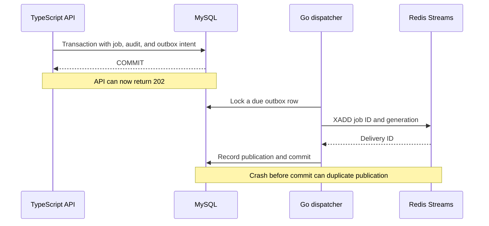
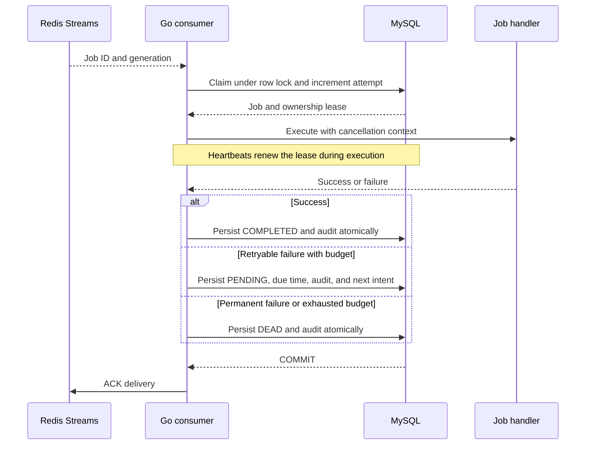

# ScaleQueue design guide

This guide describes implemented behavior. Email and notification handlers simulate work;
no external messages or payments are sent.

## Acceptance and delivery

The API returns acceptance after MySQL commits the job and outbox intent. Redis can be
temporarily unavailable without losing that dispatch intent.

Intents for nonterminal work become eligible for republishing after 30 seconds.
This is a delivery repair path, not a strict completion-time guarantee.

## Execution and durable retry

A row lock serializes claims. A renewable lease controls which owner may persist
an outcome. A retry is a future outbox entry, not an in-memory sleep.

If persistence or ownership checks fail, the consumer leaves the delivery pending.
Active-lease duplicates wait for recovery; terminal/old-generation duplicates can
be acknowledged without executing a handler.

## Two distinct identities

| Identity | Scope | Purpose |
| --- | --- | --- |
| Client + Idempotency-Key | Job acceptance | Repeated equivalent HTTP requests identify the same job |
| Job ID + generation | Execution/replay | Old deliveries cannot execute a deliberately replayed generation |
| Lease owner | Current attempt | Expired/stale owners cannot persist outcomes |

A replay increments generation and resets the attempt budget. For real external effects,
use an appropriate downstream idempotency key; leases alone cannot prevent every
external duplicate after interruption.

## How to inspect the implementation

- API transactions and replay: `api-service/src/services/jobService.ts`.
- Claims, fencing, outcomes, and dispatch: `worker-service/internal/db/mysql.go`.
- Heartbeat/handler coordination: `worker-service/internal/worker/worker.go`.
- Stream delivery and cursor recovery: `worker-service/internal/queue/consumer.go`.
- Failure tests: `worker-service/internal/db/integration_test.go`,
  `worker-service/internal/queue/consumer_test.go`, and `scripts/integration.cjs`.

See [reliability](reliability.md) for upgrade instructions and boundaries, and
[validation](validation.md) for the checks actually executed.
